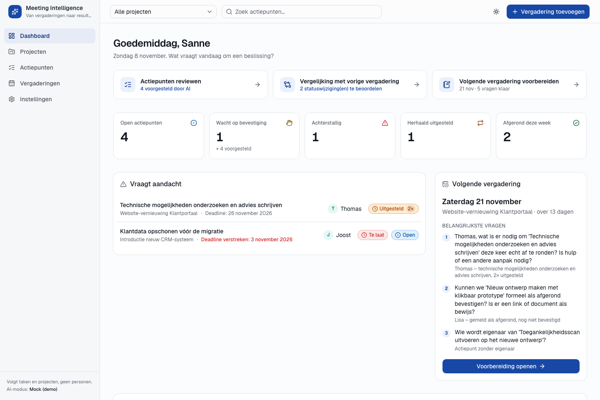
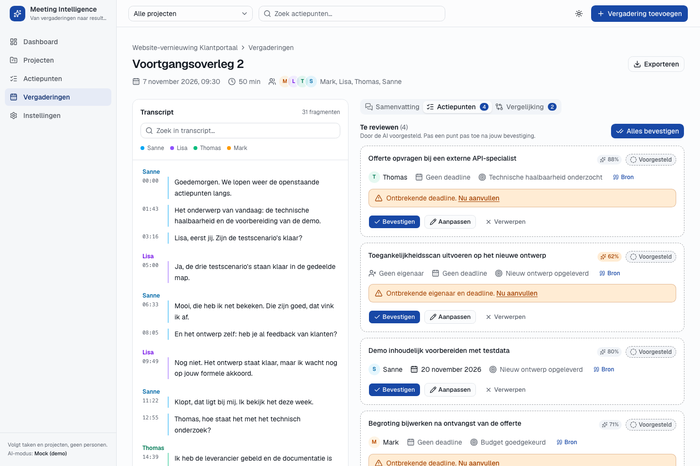
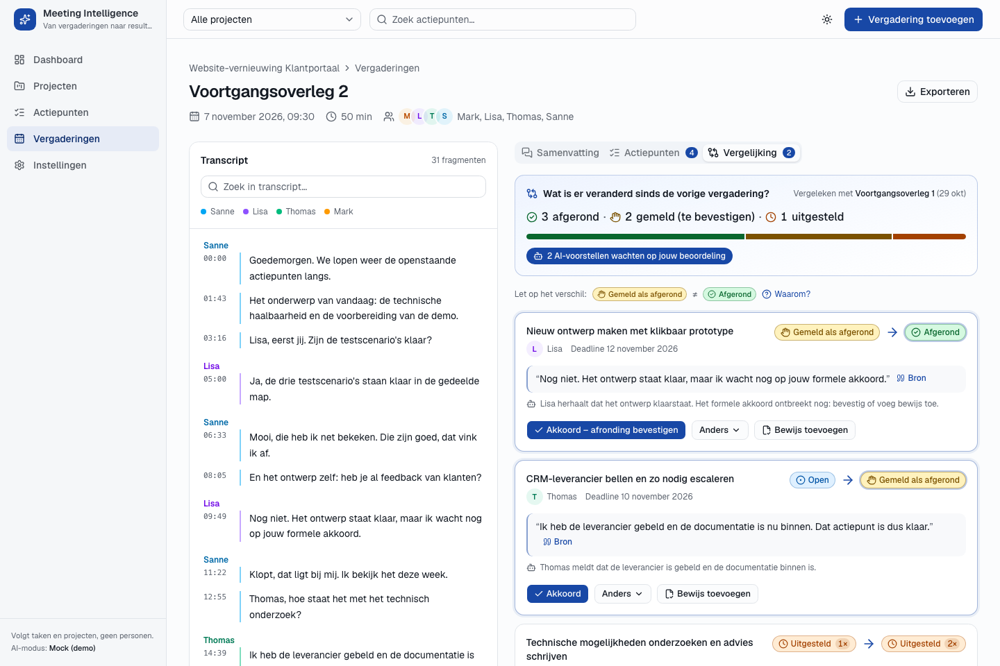
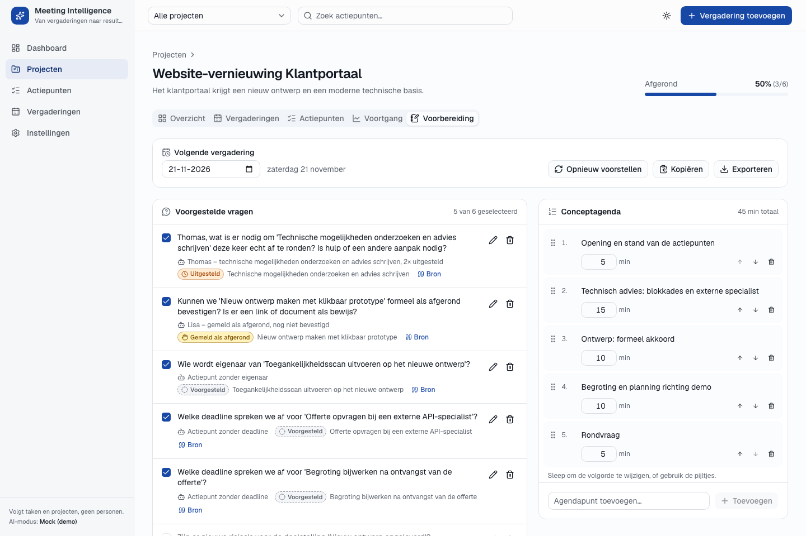
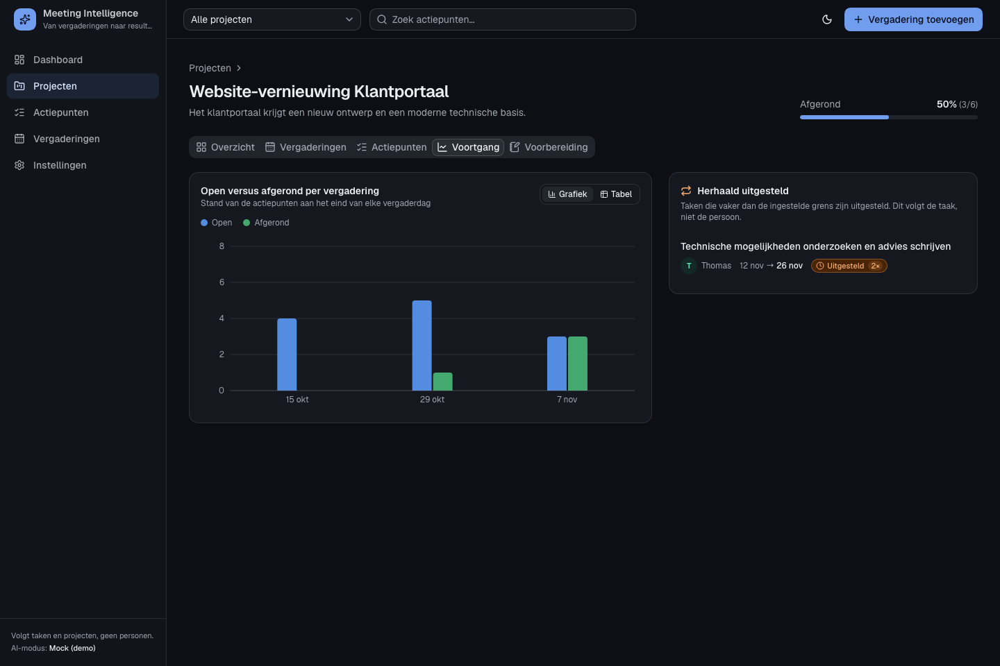

# AI Meeting Intelligence System

> **Van vergaderingen naar concrete resultaten.**

Klikbaar prototype dat vergaderingen omzet in samenvattingen, besluiten en actiepunten. Het volgt de voortgang
van actiepunten over meerdere vergaderingen en helpt de volgende vergadering voor te bereiden.

Standaard lopen alle AI-functies via een `MockProvider` met realistische Nederlandse demodata, volledig offline.
Met `AI_PROVIDER=anthropic` analyseert **Claude** de vergaderingen en transcribeert **Whisper** de opnames
lokaal op je eigen computer. De UI praat alleen met de abstracte `AIProvider`-interface. Zie
[docs/LLM_INTEGRATIE.md](docs/LLM_INTEGRATIE.md).



## Vereisten

| Tool    | Versie |
| ------- | ------ |
| Node.js | 20 of hoger (22+ voor `npm run screenshots`) |
| Python  | 3.11 of hoger |

## Installeren en starten

**Windows (PowerShell)**

```powershell
.\start.ps1
```

> Krijg je een melding over het uitvoeringsbeleid? Start dan eenmalig met
> `powershell -ExecutionPolicy Bypass -File .\start.ps1`.

**macOS / Linux**

```bash
./start.sh
```

Of handmatig (alle platformen):

```bash
npm run setup   # eenmalig: root + frontend-pakketten, backend/.venv + Python-pakketten
npm run dev     # start backend (poort 8000) en frontend (poort 5173) tegelijk
```

Open daarna <http://localhost:5173>. API-documentatie (OpenAPI): <http://localhost:8000/docs>.

Bij de eerste start wordt de database (`backend/data/meetings.db`) automatisch gevuld met demodata. Alle
datums zijn relatief aan vandaag, zodat de demo altijd actueel oogt.

| Commando              | Wat het doet |
| --------------------- | ------------ |
| `npm run dev`         | Backend + frontend starten |
| `npm run seed`        | Database leegmaken en opnieuw vullen met demodata |
| `npm run test`        | Backend-tests (pytest) |
| `npm run build`       | Productiebuild van de frontend (inclusief typecontrole) |
| `npm run screenshots` | Screenshots maken van de belangrijkste schermen (zie hieronder) |
| `npm run schemas`     | JSON-schema's van de AI-output exporteren naar `docs/schemas/` |
| `npm run setup:ai`    | Extra pakketten voor echte AI installeren (Claude + Whisper) |

Configuratie staat in `.env` (zie [`.env.example`](.env.example)). Standaard: `AI_PROVIDER=mock`.
`MOCK_DELAY_SECONDS` bepaalt hoe lang elke gesimuleerde AI-stap duurt.

### Echte AI inschakelen (Claude + lokale Whisper)

```bash
npm run setup:ai          # eenmalig: anthropic + faster-whisper
```

Zet daarna in `.env`: `AI_PROVIDER=anthropic` en `ANTHROPIC_API_KEY=sk-ant-...`, en herstart met `npm run dev`.
Details, kosten en beperkingen: [docs/LLM_INTEGRATIE.md](docs/LLM_INTEGRATIE.md).

## Rondleiding door de demo

1. **Dashboard**: KPI's, "Vraagt aandacht" (Thomas' technisch onderzoek is 2× uitgesteld) en de drie
   kernfuncties binnen één klik.
2. **Actiepunten reviewen** → *Voortgangsoverleg 2*: vier door de AI voorgestelde actiepunten. Vul de
   ontbrekende eigenaar aan, bevestig of verwerp. Klik op **Bron** om het fragment in het transcript te zien.
3. **Vergelijking**: per actiepunt vorige status → voorgestelde status, met citaat. Let op het verschil tussen
   *Gemeld als afgerond* (Lisa's ontwerp) en *Afgerond*.
4. **Voorbereiding**: voorgestelde vragen voor de volgende vergadering en een conceptagenda (slepen om te ordenen).
5. **Actiepunten** → kanban, en klik op een kaart voor de volledige historie.
6. **+ Vergadering toevoegen**: kies *Gebruik een voorbeeldopname* en volg de verwerking stap voor stap.

Terug naar de beginsituatie: `npm run seed`.

## Screenshots

| | |
|---|---|
|  |  |
| Vergadering detail: review van actiepunten | Vergelijking met de vorige vergadering |
|  |  |
| Voorbereiding volgende vergadering | Voortgang per vergadering (donker thema) |

Alle screenshots staan in [`docs/screenshots/`](docs/screenshots/), in licht en donker thema.

### Screenshots opnieuw maken

1. Zet de demodata terug en start de app: `npm run seed` en daarna `npm run dev`.
2. Voer in een tweede terminal uit: `npm run screenshots`.

Het script gebruikt je lokale Google Chrome, Chromium of Microsoft Edge (headless), zonder extra pakketten.
Opties:

```bash
npm run screenshots -- --themes light,dark --sizes laptop,tablet,mobiel
```

Wordt de browser niet gevonden, zet dan `CHROME_PATH`, bijvoorbeeld in PowerShell:
`$env:CHROME_PATH="C:\Program Files (x86)\Microsoft\Edge\Application\msedge.exe"; npm run screenshots`.
Handmatig kan ook: open de pagina in de browser, druk op F12 → apparaatwerkbalk (Ctrl+Shift+M) en kies
*Capture screenshot* in het menu (⋮).

## Projectstructuur

```
├── backend/                 FastAPI + SQLModel + SQLite
│   ├── app/
│   │   ├── ai/              AIProvider-interface, MockProvider, stubs (OpenAI, Anthropic, Whisper), JSON-schema's
│   │   ├── routers/         REST-endpoints (prefix /api)
│   │   ├── models.py        Domeinmodel (Project, Doelstelling, Vergadering, Actiepunt, Statuswijziging, …)
│   │   ├── status.py        Statusmodel van actiepunten (overgangsregels)
│   │   ├── processing.py    Verwerkingspijplijn: transcriberen → … → voorbereiding
│   │   ├── services.py      KPI's, voortgang, opbouw van API-objecten
│   │   └── seed.py          Demodata (2 projecten, 4 vergaderingen)
│   └── tests/               pytest
├── frontend/                React + Vite + TypeScript + Tailwind + shadcn/ui
│   └── src/
│       ├── components/      Layout, StatusBadge, SourceLink, TranscriptView, ActionItemCard, …
│       ├── pages/           Schermen
│       ├── hooks/           TanStack Query-hooks (ophalen en wijzigen)
│       └── lib/             API-client, types, statusmetadata, opmaak
├── docs/                    LLM-integratie, JSON-schema's, screenshots
├── scripts/                 Platformonafhankelijke start-, setup- en screenshotscripts
├── start.ps1 / start.sh     Eén commando om alles te starten
└── .env.example
```

## Statusmodel actiepunten

| Status              | Weergave                    | Betekenis |
| ------------------- | --------------------------- | --------- |
| Voorgesteld         | grijs, gestippelde rand     | Door AI herkend, nog niet bevestigd |
| Open                | blauw                       | Bevestigde taak |
| Uitgesteld          | oranje + teller ("2×")      | Deadline verschoven |
| Gemeld als afgerond | amber + hand-icoon          | Iemand zegt dat het klaar is, nog niet bevestigd |
| Afgerond            | groen + vinkje              | Bevestigd door eigenaar of met bewijs |
| Vervallen           | doorgestreept grijs         | Niet meer relevant |

**Kernregel:** een actiepunt gaat nooit direct van *Gemeld als afgerond* naar *Afgerond* zonder expliciete
gebruikersactie (**Bevestigen** of **Bewijs toevoegen**). De AI mag zelf nooit iets afronden. Afgedwongen in
`backend/app/status.py` en getest in `backend/tests/test_status_model.py`.

## Toegankelijkheid en ontwerp

- Status is nooit alleen aan kleur te herkennen: elke badge heeft een icoon, tekst en een tooltip met uitleg.
- Volledig met het toetsenbord te bedienen; zichtbare focus; "Naar de inhoud"-link; agenda ook te ordenen met pijltjesknoppen.
- Licht en donker thema (volgt het systeem of kies het zelf); grafiekkleuren gecontroleerd op contrast en kleurenblindheid.
- Laptop eerst, bruikbaar op tablet en mobiel.

## Privacy

Het systeem volgt **taken en projecten, geen personen**: er zijn bewust geen persoonsscores of ranglijsten
(AVG / AI Act). Een upload vereist de bevestiging dat alle deelnemers over de opname zijn geïnformeerd. In het
prototype wordt audio alleen tijdens het transcriberen tijdelijk opgeslagen en daarna direct verwijderd.

## Fasering

- [x] **Fase 1 – Fundament**: backend, modellen, seed-data, MockProvider, API, frontend-skelet, thema, dashboard
- [x] **Fase 2 – Kernschermen**: vergadering detail (transcript, samenvatting, review, bronlinks), actiepunten (tabel + kanban + historiepaneel)
- [x] **Fase 3 – USP-schermen**: vergelijkingsweergave, voorbereiding (vragen + conceptagenda met drag & drop), projectpagina's met voortgangsgrafiek
- [x] **Fase 4 – Wizard en instellingen**: upload-wizard met gesimuleerde verwerking in 5 stappen, sprekers koppelen, instellingen
- [x] **Echte AI**: Claude (analyse) + lokale Whisper (transcriptie), validatie van AI-output, opnieuw analyseren
- [x] **Fase 5 – Afwerking**: lege toestanden en laadtoestanden, donker thema en responsive controle, screenshots, [LLM-integratiegids](docs/LLM_INTEGRATIE.md)
