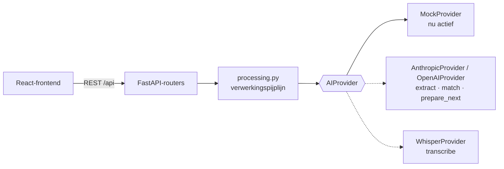

# Een echte LLM en Whisper aansluiten

Het prototype draait volledig op de `MockProvider`. De interface, de API en de database praten alleen met de
abstracte `AIProvider`. Een echte taalmodel- en spraakherkenningskoppeling vervangt daarom **alleen de AI-laag**;
frontend, routers en datamodel blijven ongewijzigd, zolang de nieuwe provider exact dezelfde JSON-schema's teruggeeft.



## 1. Welke bestanden pas je aan?

| Bestand | Wat er moet gebeuren |
|---|---|
| `backend/app/ai/anthropic_provider.py` (of `openai_provider.py`) | `extract`, `match` en `prepare_next` implementeren (zie §4). `transcribe` delegeren naar Whisper. |
| `backend/app/ai/whisper_provider.py` | `transcribe` implementeren: audio → `Transcript` met sprekerlabels en tijdstempels (zie §5). |
| `backend/app/ai/__init__.py` | In `get_provider()` de nieuwe provider teruggeven, bijvoorbeeld een samengestelde provider (Whisper voor spraak, LLM voor de rest). |
| `backend/requirements.txt` | SDK's toevoegen, bijv. `anthropic` en `faster-whisper`. |
| `.env` | `AI_PROVIDER=anthropic` en `ANTHROPIC_API_KEY=...` (nooit in code of versiebeheer). |
| `backend/app/routers/settings.py` | In `PROVIDERS` de gekozen provider op `"available": True` zetten, zodat de instellingenpagina hem toont. |

**Niet aanpassen:** `frontend/`, `backend/app/routers/*` (behalve de providerlijst), `models.py`, `status.py`,
`processing.py`. De pijplijn roept de vier methoden al in de juiste volgorde aan en slaat de resultaten op.

## 2. Het contract: vier methoden

Gedefinieerd in [`backend/app/ai/base.py`](../backend/app/ai/base.py); alle schema's staan in
[`backend/app/ai/schemas.py`](../backend/app/ai/schemas.py) en als JSON Schema in [`docs/schemas/`](schemas/).

| Methode | Invoer | Uitvoer | Schema |
|---|---|---|---|
| `transcribe(audio, hints)` | audiobytes + `TranscriptionHints` (deelnemersnamen, taal) | `Transcript` | [`transcript.schema.json`](schemas/transcript.schema.json) |
| `extract(transcript)` | `Transcript` | `MeetingAnalysis` | [`meeting_analysis.schema.json`](schemas/meeting_analysis.schema.json) |
| `match(analysis, open_items)` | `MeetingAnalysis` + `list[OpenActionItemRef]` | `list[StatusSuggestion]` | [`status_suggestion.schema.json`](schemas/status_suggestion.schema.json) |
| `prepare_next(project_state)` | `ProjectState` | `list[PrepQuestionDraft]` | [`prep_question_draft.schema.json`](schemas/prep_question_draft.schema.json) |

Schema's opnieuw genereren na een wijziging in `schemas.py`: `npm run schemas`. De test
`backend/tests/test_schemas_docs.py` faalt als `docs/schemas/` verouderd is.

### Spelregels die elke implementatie moet volgen

1. **Bronverwijzing via `segment_index`**: de 0-gebaseerde positie in `transcript.segments`. Elk besluit,
   probleem, actiepunt en statusvoorstel heeft er één; de UI gebruikt het voor de knop "Bron".
2. **Eigenaren**: `owner_name` is exact een naam uit `transcript.participant_names`, of `null`. Nooit raden;
   een ontbrekende eigenaar levert in de UI een waarschuwing op, en dat is de bedoeling.
3. **Datums**: ISO-formaat `YYYY-MM-DD`. Relatieve datums ("volgende week vrijdag") omrekenen vanaf de vergaderdatum.
4. **Statusvoorstellen** (`match`): bij "het is klaar" stel je `gemeld_afgerond` voor, niet `afgerond`. De
   backend laat de AI nooit zelf iets afronden (`status.py`); elk voorstel wacht op een mens ("Akkoord").
   Geen voorstel teruggeven als een actiepunt niet besproken is.
5. **Geen personen beoordelen**: geen scores, rangschikkingen of oordelen over medewerkers in de output.
   Formuleer redenen over de taak ("2× uitgesteld"), niet over de persoon.
6. **Citaten letterlijk**: `quote` in een `StatusSuggestion` is de letterlijke tekst van het bronsegment.

### Voorbeeld `MeetingAnalysis`

```json
{
  "topics": [{ "text": "Technische haalbaarheid van de CRM-koppeling", "segment_index": 1 }],
  "decisions": [{ "text": "De demo gebruikt testdata; de echte koppeling volgt later.", "segment_index": 20 }],
  "problems": [{ "text": "De CRM-API werkt anders dan verwacht.", "segment_index": 10 }],
  "ideas": [],
  "agreements": [{ "text": "Blokkades direct melden in het projectkanaal.", "segment_index": 29 }],
  "deadlines": [{ "text": "Technisch advies verschoven naar 24 november.", "segment_index": 27 }],
  "action_items": [
    {
      "title": "Offerte opvragen bij een externe API-specialist",
      "description": "",
      "owner_name": "Thomas",
      "deadline": null,
      "goal_hint": "Technische haalbaarheid onderzocht",
      "segment_index": 21,
      "confidence": 0.88
    }
  ],
  "progress_updates": [
    {
      "subject_name": "Thomas",
      "text": "Ik heb echt tot 24 november nodig.",
      "kind": "uitgesteld",
      "new_deadline": "2026-11-24",
      "segment_index": 12
    }
  ]
}
```

## 3. Voorbeeldprompt voor de extractie

Systeemprompt (Nederlands, met de spelregels van §2). Houd hem stabiel: dan kan de prefix gecachet worden.

```text
Je analyseert het transcript van een projectvergadering en legt vast wat er is besproken en afgesproken.

Werkwijze:
- Elk transcriptsegment begint met [index]. Verwijs bij elk item naar het segment waarop het gebaseerd is
  (segment_index). Kies het segment waarin de afspraak of uitspraak het duidelijkst staat.
- Actiepunten zijn concrete taken die iemand op zich neemt of krijgt toegewezen. Geen vage intenties.
  Formuleer de titel als taak die begint met een werkwoord ("Offerte opvragen bij ...").
- owner_name is precies een naam uit de deelnemerslijst. Als niet duidelijk is wie het doet: null.
- deadline als YYYY-MM-DD, berekend vanaf de vergaderdatum. Geen deadline genoemd: null.
- goal_hint is de titel van de projectdoelstelling waar het punt bij hoort, of null.
- progress_updates zijn uitspraken over de voortgang van eerder afgesproken werk: klaar (gemeld_afgerond),
  uitgesteld (met nieuwe deadline als die genoemd wordt), nog bezig, of niet meer nodig (vervallen).
- Beoordeel geen personen. Beschrijf taken en afspraken neutraal.
- Verzin niets: als iets niet in het transcript staat, laat je het weg.
```

Gebruikersbericht: vergaderdatum, deelnemerslijst, projectdoelstellingen en het genummerde transcript:

```text
Vergaderdatum: 2026-11-05
Deelnemers: Mark, Lisa, Thomas, Sanne
Doelstellingen: Nieuw ontwerp opgeleverd; Technische haalbaarheid onderzocht; Budget goedgekeurd

[0] Sanne (00:00): Goedemorgen. We lopen weer de openstaande actiepunten langs.
[1] Sanne (01:43): Het onderwerp van vandaag: de technische haalbaarheid ...
...
```

## 4. Voorbeeld: `AnthropicProvider.extract`

Met de officiële Python-SDK (`pip install anthropic`) en structured outputs: `messages.parse` valideert het
antwoord direct tegen het Pydantic-model `MeetingAnalysis`. Standaardmodel: `claude-opus-5-5`.

```python
from anthropic import AsyncAnthropic

from .schemas import MeetingAnalysis, Transcript

EXTRACT_SYSTEM = """..."""  # de systeemprompt uit §3


def _format_transcript(t: Transcript) -> str:
    lines = []
    for i, s in enumerate(t.segments):
        m, sec = divmod(int(s.start_seconds), 60)
        lines.append(f"[{i}] {s.speaker_label} ({m:02d}:{sec:02d}): {s.text}")
    return "\n".join(lines)


class AnthropicProvider(AIProvider):
    name = "anthropic"

    def __init__(self, api_key: str | None) -> None:
        self.client = AsyncAnthropic(api_key=api_key)  # of zonder argument: leest ANTHROPIC_API_KEY

    async def extract(self, transcript: Transcript) -> MeetingAnalysis:
        response = await self.client.messages.parse(
            model="claude-opus-5-5",
            max_tokens=16000,
            system=EXTRACT_SYSTEM,
            messages=[{
                "role": "user",
                "content": f"Deelnemers: {', '.join(transcript.participant_names)}\n\n"
                           + _format_transcript(transcript),
            }],
            output_format=MeetingAnalysis,
        )
        if response.stop_reason == "refusal":
            raise RuntimeError("De AI heeft deze analyse geweigerd.")
        return response.parsed_output
```

Aandachtspunten:

- **Vergaderdatum en doelen**: geef ze mee in het gebruikersbericht (pas daarvoor de aanroep in `processing.py`
  niet aan; zet ze bijvoorbeeld in een extra veld van `Transcript` of in de `TranscriptionHints`).
- **Schema-ondersteuning**: test bij de eerste aanroep of het schema geaccepteerd wordt. Geeft de API een fout
  op beperkingen zoals `ge`/`le` (bijv. `confidence`), haal die dan uit het model en valideer achteraf.
- **Refusals**: controleer altijd `stop_reason` voordat je de output leest. Voor productie kun je server-side
  fallbacks inschakelen (zie de documentatie van Anthropic over *refusals and fallback*).
- **Lange vergaderingen**: een transcript van een uur past ruim in het contextvenster; splitsen is niet nodig.
- `match` en `prepare_next` volgen hetzelfde patroon met `output_format` als lijst-wrapper, bijvoorbeeld
  `class Suggestions(BaseModel): items: list[StatusSuggestion]`.

## 5. Whisper: `WhisperProvider.transcribe`

Lokaal met [`faster-whisper`](https://github.com/SYSTRAN/faster-whisper); sprekerherkenning (diarisatie) met
bijvoorbeeld `pyannote.audio`. Schets:

```python
from faster_whisper import WhisperModel

class WhisperProvider:
    def __init__(self, model_size: str = "medium") -> None:
        self.model = WhisperModel(model_size, compute_type="int8")

    async def transcribe(self, audio: bytes, hints: TranscriptionHints | None = None) -> Transcript:
        # 1. audio naar een tijdelijk bestand schrijven (en daarna direct verwijderen: bewaartermijn "direct")
        # 2. segments, info = self.model.transcribe(path, language=hints.language,
        #        initial_prompt=", ".join(hints.participant_names))   # namen helpen bij de spelling
        # 3. diarisatie: wijs elk segment een label "Spreker N" toe
        # 4. return Transcript(language=..., duration_seconds=info.duration,
        #        participant_names=hints.participant_names,
        #        segments=[TranscriptSegmentData(speaker_label=..., start_seconds=s.start,
        #                                        end_seconds=s.end, text=s.text.strip()) ...])
        ...
```

Draai zware modellen niet in de request-thread: `processing.py` voert de verwerking al als achtergrondtaak uit.
Voor productie is een echte takenwachtrij (bijv. Celery of RQ) aan te raden.

## 6. Testen

1. Draai de bestaande tests: `npm run test`. De statusmodel-tests blijven gelden, ongeacht de provider.
2. Voeg een contracttest toe die de nieuwe provider met een kort Nederlands transcript aanroept en controleert
   dat elke `segment_index` binnen het transcript valt en dat `owner_name` in de deelnemerslijst staat.
3. Vergelijk de output met de mock op de demovergaderingen (`backend/app/seed_data.py`).

## 7. Privacy en AVG

- Sluit een verwerkersovereenkomst met de AI-leverancier en kies waar mogelijk verwerking binnen de EU.
- Audio na transcriptie direct verwijderen (standaardinstelling); transcripten volgens de ingestelde bewaartermijn.
- Opnamemelding blijft verplicht in de wizard (`consent_required`).
- Het systeem volgt taken en projecten, geen personen: geen persoonsscores of ranglijsten toevoegen.
