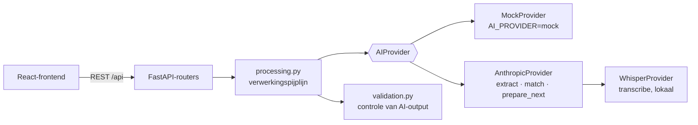

# Echte AI: Claude en lokale Whisper

Standaard draait het prototype op de `MockProvider` (offline demodata). Er is ook een **echte koppeling**:

- **Claude** (Anthropic, model `claude-opus-5-5`) voor extractie, vergelijking en voorbereiding, via structured
  outputs zodat de antwoorden exact de schema's uit `backend/app/ai/schemas.py` volgen;
- **faster-whisper** voor lokale transcriptie: de audio verlaat de computer niet.

De interface, de API en de database praten alleen met de abstracte `AIProvider`; voor de koppeling is aan de
frontend niets veranderd behalve weergave (actieve modus, foutmeldingen, "Opnieuw analyseren").

## Snel aan de slag

1. Installeer de extra pakketten (eenmalig): `npm run setup:ai`
2. Zet in `.env` (zie [`.env.example`](../.env.example)):
   ```env
   AI_PROVIDER=anthropic
   ANTHROPIC_API_KEY=sk-ant-...
   TRANSCRIBER=whisper
   WHISPER_MODEL=small
   ```
3. Herstart: `npm run dev`. Onder **Instellingen** zie je de actieve provider en of de sleutel is ingesteld.
4. Upload via **+ Vergadering toevoegen** een echte opname (mp3, m4a, wav, …).

Bij de eerste transcriptie downloadt Whisper het model eenmalig (`small` ≈ 480 MB). Op een laptop zonder GPU
duurt transcriberen ongeveer even lang als de opname; kies `WHISPER_MODEL=base` voor sneller en iets minder
nauwkeurig, of `medium` voor nauwkeuriger en trager. Wil je alleen de analyse door Claude beoordelen, zet dan
`TRANSCRIBER=mock`: dan wordt de vaste demotekst geanalyseerd.

### Kosten en gedrag

- Per vergadering doet de backend drie aanroepen naar Claude (analyseren, vergelijken, voorbereiden); bij een
  vergadering zonder voortgangsuitspraken vervalt de vergelijking. `ANTHROPIC_EFFORT` (standaard `high`) bepaalt
  hoe grondig Claude nadenkt; `medium` is goedkoper.
- Weigert Claude een verzoek (veiligheidsfilter), dan probeert de API het automatisch op een ander model
  (server-side fallback, `fallbacks: "default"`).
- Mislukt de analyse (geen sleutel, netwerk, limiet), dan blijft het transcript bewaard en kun je in de wizard of
  op de vergaderpagina op **Opnieuw analyseren** klikken; opnieuw uploaden is niet nodig.
- Alle AI-output gaat door [`backend/app/ai/validation.py`](../backend/app/ai/validation.py): verwijzingen naar
  niet-bestaande segmenten, onbekende namen of id's worden verwijderd, en een melding "het is klaar" wordt nooit
  direct "Afgerond".

### Beperkingen

- **Sprekerherkenning** (diarisatie) zit er nog niet in: Whisper levert alles als "Spreker 1". Koppel sprekers
  handmatig of laat het leeg. Uitbreiden kan met `pyannote.audio` (vereist een Hugging Face-token), zie §5.
- De OpenAI-provider is nog een stub.

## Hoe het in elkaar zit



## 1. Welke bestanden horen bij de koppeling?

| Bestand | Wat er moet gebeuren |
|---|---|
| `backend/app/ai/anthropic_provider.py` | ✅ `extract`, `match` en `prepare_next` met Claude (zie §4); `transcribe` delegeert naar de transcriber. |
| `backend/app/ai/prompts.py` | ✅ De drie systeemprompts (Nederlands, stabiel voor caching). |
| `backend/app/ai/whisper_provider.py` | ✅ Lokale transcriptie met faster-whisper (zie §5). |
| `backend/app/ai/validation.py` | ✅ Controle van AI-output, voor elke provider. |
| `backend/app/ai/__init__.py` | ✅ `get_provider()` / `get_transcriber()` kiezen op basis van `.env`. |
| `backend/requirements-ai.txt` | ✅ `anthropic` en `faster-whisper` (installeren met `npm run setup:ai`). |
| `backend/app/ai/openai_provider.py` | Nog een stub; zelfde patroon als de Anthropic-provider. |

De pijplijn (`processing.py`) roept de vier methoden in vaste volgorde aan, valideert de uitvoer en slaat hem op.

## 2. Het contract: vier methoden

Gedefinieerd in [`backend/app/ai/base.py`](../backend/app/ai/base.py); alle schema's staan in
[`backend/app/ai/schemas.py`](../backend/app/ai/schemas.py) en als JSON Schema in [`docs/schemas/`](schemas/).

| Methode | Invoer | Uitvoer | Schema |
|---|---|---|---|
| `transcribe(audio, hints)` | audiobytes + `TranscriptionHints` (deelnemersnamen, taal) | `Transcript` | [`transcript.schema.json`](schemas/transcript.schema.json) |
| `extract(transcript)` | `Transcript` | `MeetingAnalysis` | [`meeting_analysis.schema.json`](schemas/meeting_analysis.schema.json) |
| `match(analysis, open_items)` | `MeetingAnalysis` + `list[OpenActionItemRef]` | `list[StatusSuggestion]` | [`status_suggestion.schema.json`](schemas/status_suggestion.schema.json) |
| `prepare_next(project_state)` | `ProjectState` | `list[PrepQuestionDraft]` | [`prep_question_draft.schema.json`](schemas/prep_question_draft.schema.json) |

Schema's opnieuw genereren na een wijziging in `schemas.py`: `npm run schemas`. De test
`backend/tests/test_schemas_docs.py` faalt als `docs/schemas/` verouderd is.

### Spelregels die elke implementatie moet volgen

1. **Bronverwijzing via `segment_index`**: de 0-gebaseerde positie in `transcript.segments`. Elk besluit,
   probleem, actiepunt en statusvoorstel heeft er één; de UI gebruikt het voor de knop "Bron".
2. **Eigenaren**: `owner_name` is exact een naam uit `transcript.participant_names`, of `null`. Nooit raden;
   een ontbrekende eigenaar levert in de UI een waarschuwing op, en dat is de bedoeling.
3. **Datums**: ISO-formaat `YYYY-MM-DD`. Relatieve datums ("volgende week vrijdag") omrekenen vanaf de vergaderdatum.
4. **Statusvoorstellen** (`match`): bij "het is klaar" stel je `gemeld_afgerond` voor, niet `afgerond`. De
   backend laat de AI nooit zelf iets afronden (`status.py`); elk voorstel wacht op een mens ("Akkoord").
   Geen voorstel teruggeven als een actiepunt niet besproken is.
5. **Geen personen beoordelen**: geen scores, rangschikkingen of oordelen over medewerkers in de output.
   Formuleer redenen over de taak ("2× uitgesteld"), niet over de persoon.
6. **Citaten letterlijk**: `quote` in een `StatusSuggestion` is de letterlijke tekst van het bronsegment.

### Voorbeeld `MeetingAnalysis`

```json
{
  "topics": [{ "text": "Technische haalbaarheid van de CRM-koppeling", "segment_index": 1 }],
  "decisions": [{ "text": "De demo gebruikt testdata; de echte koppeling volgt later.", "segment_index": 20 }],
  "problems": [{ "text": "De CRM-API werkt anders dan verwacht.", "segment_index": 10 }],
  "ideas": [],
  "agreements": [{ "text": "Blokkades direct melden in het projectkanaal.", "segment_index": 29 }],
  "deadlines": [{ "text": "Technisch advies verschoven naar 24 november.", "segment_index": 27 }],
  "action_items": [
    {
      "title": "Offerte opvragen bij een externe API-specialist",
      "description": "",
      "owner_name": "Thomas",
      "deadline": null,
      "goal_hint": "Technische haalbaarheid onderzocht",
      "segment_index": 21,
      "confidence": 0.88
    }
  ],
  "progress_updates": [
    {
      "subject_name": "Thomas",
      "text": "Ik heb echt tot 24 november nodig.",
      "kind": "uitgesteld",
      "new_deadline": "2026-11-24",
      "segment_index": 12
    }
  ]
}
```

## 3. Voorbeeldprompt voor de extractie

Systeemprompt (Nederlands, met de spelregels van §2). Houd hem stabiel: dan kan de prefix gecachet worden.

```text
Je analyseert het transcript van een projectvergadering en legt vast wat er is besproken en afgesproken.

Werkwijze:
- Elk transcriptsegment begint met [index]. Verwijs bij elk item naar het segment waarop het gebaseerd is
  (segment_index). Kies het segment waarin de afspraak of uitspraak het duidelijkst staat.
- Actiepunten zijn concrete taken die iemand op zich neemt of krijgt toegewezen. Geen vage intenties.
  Formuleer de titel als taak die begint met een werkwoord ("Offerte opvragen bij ...").
- owner_name is precies een naam uit de deelnemerslijst. Als niet duidelijk is wie het doet: null.
- deadline als YYYY-MM-DD, berekend vanaf de vergaderdatum. Geen deadline genoemd: null.
- goal_hint is de titel van de projectdoelstelling waar het punt bij hoort, of null.
- progress_updates zijn uitspraken over de voortgang van eerder afgesproken werk: klaar (gemeld_afgerond),
  uitgesteld (met nieuwe deadline als die genoemd wordt), nog bezig, of niet meer nodig (vervallen).
- Beoordeel geen personen. Beschrijf taken en afspraken neutraal.
- Verzin niets: als iets niet in het transcript staat, laat je het weg.
```

Gebruikersbericht: vergaderdatum, deelnemerslijst, projectdoelstellingen en het genummerde transcript:

```text
Vergaderdatum: 2026-11-05
Deelnemers: Mark, Lisa, Thomas, Sanne
Doelstellingen: Nieuw ontwerp opgeleverd; Technische haalbaarheid onderzocht; Budget goedgekeurd

[0] Sanne (00:00): Goedemorgen. We lopen weer de openstaande actiepunten langs.
[1] Sanne (01:43): Het onderwerp van vandaag: de technische haalbaarheid ...
...
```

## 4. `AnthropicProvider` (zoals geïmplementeerd)

Met de officiële Python-SDK en structured outputs: `beta.messages.parse` valideert het antwoord direct tegen
het Pydantic-model. Hieronder de kern in vereenvoudigde vorm; de volledige code met foutafhandeling staat in
[`anthropic_provider.py`](../backend/app/ai/anthropic_provider.py).

```python
from anthropic import AsyncAnthropic

from .schemas import MeetingAnalysis, Transcript

EXTRACT_SYSTEM = """..."""  # de systeemprompt uit §3


def _format_transcript(t: Transcript) -> str:
    lines = []
    for i, s in enumerate(t.segments):
        m, sec = divmod(int(s.start_seconds), 60)
        lines.append(f"[{i}] {s.speaker_label} ({m:02d}:{sec:02d}): {s.text}")
    return "\n".join(lines)


class AnthropicProvider(AIProvider):
    name = "anthropic"

    def __init__(self, api_key: str | None) -> None:
        self.client = AsyncAnthropic(api_key=api_key)  # of zonder argument: leest ANTHROPIC_API_KEY

    async def extract(self, transcript: Transcript) -> MeetingAnalysis:
        response = await self.client.beta.messages.parse(
            model="claude-opus-5-5",
            max_tokens=16000,
            system=EXTRACT_SYSTEM,
            messages=[{
                "role": "user",
                "content": f"Deelnemers: {', '.join(transcript.participant_names)}\n\n"
                           + _format_transcript(transcript),
            }],
            output_format=MeetingAnalysis,
            output_config={"effort": "high"},
            betas=["server-side-fallback-2026-07-01"],
            fallbacks="default",  # bij een weigering automatisch een ander model
        )
        if response.stop_reason == "refusal":
            raise RuntimeError("De AI heeft deze analyse geweigerd.")
        return response.parsed_output
```

Aandachtspunten:

- **Vergaderdatum en doelen** zitten in `Transcript.meeting_date` en `Transcript.project_goals`; de pijplijn
  vult ze in na het transcriberen en ze gaan mee in het gebruikersbericht.
- **Refusals en afgebroken antwoorden** (`stop_reason` `refusal` / `max_tokens`) worden een Nederlandse foutmelding.
- **Lange vergaderingen**: een transcript van een uur past ruim in het contextvenster; splitsen is niet nodig.
- `match` en `prepare_next` gebruiken een kleine wrapper (`{"suggestions": [...]}`, `{"questions": [...]}`).

## 5. Whisper: `WhisperProvider.transcribe` (zoals geïmplementeerd)

Lokaal met [`faster-whisper`](https://github.com/SYSTRAN/faster-whisper): audio wordt tijdelijk naar schijf
geschreven, getranscribeerd (in een aparte thread, met de deelnemersnamen als `initial_prompt`) en direct
verwijderd. Sprekerherkenning ontbreekt nog; uitbreiden met `pyannote.audio` kan op de plek van stap 3 hieronder.
Schets van de opbouw:

```python
from faster_whisper import WhisperModel

class WhisperProvider:
    def __init__(self, model_size: str = "medium") -> None:
        self.model = WhisperModel(model_size, compute_type="int8")

    async def transcribe(self, audio: bytes, hints: TranscriptionHints | None = None) -> Transcript:
        # 1. audio naar een tijdelijk bestand schrijven (en daarna direct verwijderen: bewaartermijn "direct")
        # 2. segments, info = self.model.transcribe(path, language=hints.language,
        #        initial_prompt=", ".join(hints.participant_names))   # namen helpen bij de spelling
        # 3. diarisatie: wijs elk segment een label "Spreker N" toe
        # 4. return Transcript(language=..., duration_seconds=info.duration,
        #        participant_names=hints.participant_names,
        #        segments=[TranscriptSegmentData(speaker_label=..., start_seconds=s.start,
        #                                        end_seconds=s.end, text=s.text.strip()) ...])
        ...
```

De verwerking draait als achtergrondtaak; voor productie is een echte takenwachtrij (bijv. Celery of RQ) aan te raden.

## 6. Testen

1. `npm run test` draait alles zonder netwerk: `tests/test_anthropic_provider.py` gebruikt een nagebootste
   Anthropic-client (aanroepparameters, foutmeldingen, validatie).
2. Echte test: zet de sleutel in `.env`, start de app en upload een korte opname. In de backendlog staat per
   aanroep het tokengebruik (`Claude …: input=… output=…`).

## 7. Privacy en AVG

- Sluit een verwerkersovereenkomst met de AI-leverancier en kies waar mogelijk verwerking binnen de EU.
- Audio na transcriptie direct verwijderen (standaardinstelling); transcripten volgens de ingestelde bewaartermijn.
- Opnamemelding blijft verplicht in de wizard (`consent_required`).
- Het systeem volgt taken en projecten, geen personen: geen persoonsscores of ranglijsten toevoegen.
